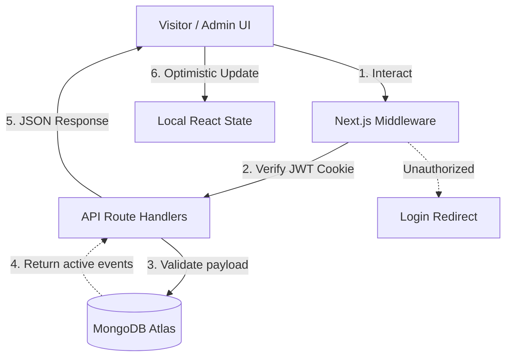

# 🎫 EventPulse: Next-Gen Community Events Board

**A High-Performance, Full-Stack Local Events Platform**

[](#)
[](#)
[](#)
[](#)

---

**EventPulse** is a highly optimized full-stack platform designed to handle browsing, curating, and managing local community events. Built strictly with Next.js App Router, TypeScript, and MongoDB, this system provides a highly tactile, zero-generic UI featuring a **Tactical Filter Console** and an **Interactive 3D Collectible Pass Studio**.

It explicitly handles authentic JWT authentication, optimistic UI updates, multi-parameter search filtering, and seamless device responsiveness.

---


---
## 🚀 Core Ecosystem Matrix

The platform is designed to guarantee secure routing, fluid user interactions, and robust data persistence.

| Module | ⚡ Design Pattern | 🧠 Implementation Details |
| :--- | :--- | :--- |
| **Authentication Engine** | `Custom JWT & Middleware` | Uses `jose` and `bcryptjs` for secure hashing. Enforces strict server-side boundaries via Next.js Middleware and HTTP-only cookies to protect the Admin Portal. |
| **Tactical Filter Console** | `Multi-Param Querying` | Combines Category, City Radar, and Text Search into a single deterministic query (`{ isActive: true, date: { $gte: now } }`). |
| **Event Pass Studio** | `Interactive 3D UI` | Renders a physical VIP lanyard pass using CSS `perspective(1100px)`. Handles dynamic cursor tracking for foil glare and calculates organic die-cut sticker stamping angles. |
| **Reminder System** | `Optimistic Rollback` | Flips "Remind Me" UI state instantly. Uses a background `fetchJson` wrapper to sync with MongoDB, automatically reverting the UI if the server connection fails. |

---

## 🏗️ System Architecture & Data Flow

The system strictly decouples the client-side UI from the database logic, ensuring fast prerendering and secure API boundaries.



---

## ⚡ Performance & Reliability Matrix

The platform addresses critical Next.js 16 rendering challenges—hydration errors, blocking routes, and file-locking—using strict software engineering principles.

| Challenge | ⚡ Feature | 🧠 Implementation Details |
| :--- | :--- | :--- |
| **Hydration Mismatches** | Client State Synchronization | Extracts `useSearchParams` logic out of initial state declarations to prevent server/client HTML drift during first paint. |
| **Blocking Routes** | `<Suspense>` Boundaries | Wraps dynamic hooks (`useParams`) inside React Suspense boundaries, preventing Next.js 16 from aborting static prerenders. |
| **Windows EPERM Locks** | `fetchJson` Polling | Implements an intelligent retry mechanism that catches transient Next.js `.tmp` file compilation errors and retries the fetch gracefully. |
| **UI Jitter** | Optimistic Execution | Updates complex UI states (like adding stickers or setting reminders) instantly, masking network latency and ensuring native-app fluidity. |

---


## ⚙️ Installation & Development

To set up and run the Community Events Board locally:

### **1. Clone the Repository**

```bash
git clone https://github.com/Gautam-Sahil/Community-events-board.git
cd community-events-board
npm install
```

### **2. Configure the Environment**

Create a `.env.local` file in the project root:

```bash
   MONGODB_URI=mongodb+srv://<YOUR_USERNAME>:<YOUR_PASSWORD>@<YOUR_CLUSTER>.mongodb.net/community-events-board?retryWrites=true&w=majority
   JWT_SECRET=super_secret_jwt_key_2026_community_board
   ADMIN_EMAIL=sahil@admin.com
   ADMIN_PASSWORD=admin123
```

### **3. Seed the Database**

Generates 15 sample events across various categories, cities, and timelines, including inactive and past events for strict filter testing.

```bash
npm run seed
```

### **4. Launch the Platform**

Starts the Next.js development server for local testing.

```bash
npm run dev
```

### **5. Access the Admin Dashboard**

Open the application in your browser and log in as an administrator using the Auto-Fill button.

```bash
http://localhost:3000/login?role=admin
```

**Note:** Ensure MongoDB is running locally before launching the application. Replace the placeholder repository URL with your actual Git repository URL before cloning.

---

## Admin & Visitor Credentials

### Admin Portal Login
- **Login URL:** [http://localhost:3000/login?role=admin](http://localhost:3000/login?role=admin) (or click **Admin** in the top navigation bar)
- **Admin Email:** `sahil@admin.com`
- **Admin Password:** `admin123`
- **Quick Fill:** Click the **Auto-Fill Admin** button on the login card to populate credentials in one click.

### Visitor Account
- Register a new visitor account at [http://localhost:3000/login?mode=register](http://localhost:3000/login?mode=register).
- Upon signup/login, the **Favourite Categories** selector opens automatically to configure your **My Feed** page.

---

## JSON API Reference (Web & Mobile Ready)

All web pages communicate exclusively with decoupled JSON API routes. Every protected endpoint accepts **both** `Authorization: Bearer <token>` headers (for mobile apps) and `httpOnly` cookies (for web sessions).

| Method | Endpoint | Access | Description |
| :--- | :--- | :--- | :--- |
| `POST` | `/api/admin/login` | Public | Authenticates admin credentials and returns a signed Admin JWT (`role: "admin"`). |
| `GET` | `/api/admin/events` | Admin Only | Returns all events (active, inactive, and past) sorted by date. |
| `POST` | `/api/admin/events` | Admin Only | Creates a new event (`title`, `category`, `city`, `date`, `price`, `description`, `imageUrl`). |
| `PATCH` | `/api/admin/events/[id]` | Admin Only | Toggles an event between `Active` (`isActive: true`) and `Inactive` (`isActive: false`). Never deletes. |
| `POST` | `/api/auth/signup` | Public | Hashes password with `bcryptjs`, creates a visitor account, and returns a signed JWT. |
| `POST` | `/api/auth/login` | Public | Verifies visitor email/password and returns a signed JWT (`role: "user"`). |
| `GET` | `/api/auth/me` | Public/Auth | Returns the active visitor profile (`favouriteCategories`, `reminders`) and admin status. |
| `POST` | `/api/auth/logout` | Public | Clears authentication cookies. |
| `GET` | `/api/events` | Public | Returns only **active, upcoming** events sorted by nearest date first (`?category=&city=&search=&page=&limit=`). |
| `GET` | `/api/events/[id]` | Public/Auth | Returns single event details, the user's saved card design, and reminder status. |
| `PUT` | `/api/events/[id]` | Visitor Auth | Saves the user's custom card design (`theme` + up to 3 `stickers`) for that event. |
| `PUT` | `/api/user/favourites` | Visitor Auth | Saves the logged-in user's favourite categories (`Music`, `Workshop`, `Food`, `Sports`, `Kids`). |
| `POST` | `/api/user/reminders` | Visitor Auth | Toggles an event ID inside the user's saved `reminders` array (powers the Optimistic UI button). |
| `GET` | `/api/feed` | Visitor Auth | Returns upcoming active events matching the user's saved `favouriteCategories`. |

---

##  Technical Architecture Answers

### 1. Show your database structure. Why did you design it this way?
- **`Event`:** `{ title, category, city, date, price, description, imageUrl, isActive, timestamps }`
- **`User`:** `{ name, email, passwordHash, favouriteCategories: [String], reminders: [ObjectId], timestamps }`
- **`CardDesign`:** `{ userId: ObjectId, eventId: ObjectId, theme: "sunset" | "ocean" | "midnight", stickers: [String] }` (unique compound key on `userId + eventId`).

Embedding `favouriteCategories` and `reminders` directly inside the `User` document allows `/api/feed` and reminder checks to resolve in a single fast lookup without expensive joins. Separating `CardDesign` into its own collection with a unique `(userId, eventId)` index keeps the core `Event` collection lightweight for public browsing while allowing per-user card persistence.

### 2. How does your filter query work, and what index would you add?
`GET /api/events` builds a single MongoDB filter object starting with `{ isActive: true, date: { \$gte: new Date() } }` so inactive and past events are strictly excluded. If provided, it dynamically attaches `category`, a case-insensitive regex on `city`, and an `\$or` regex matching `search` against `title` or `description`, then executes `.sort({ date: 1 }).skip((page - 1) * limit).limit(limit)`.
To optimize this query at scale, I added the compound index `{ isActive: 1, date: 1, category: 1, city: 1 }` following the ESR (Equality, Sort, Range) rule, alongside a text/search index on `{ title: "text", description: "text" }`.

### 3. How do you store passwords and protect the admin pages and APIs?
Visitor passwords are never stored in plain text; they are salted and hashed using `bcryptjs` (10 salt rounds) before saving `passwordHash` to MongoDB, and verified via `bcrypt.compare()`.
Admin protection is enforced on the server across three layers using `jose` (HS256 JWTs with `role: "admin"`):
1. **Next.js Server Middleware (`src/middleware.ts`):** Intercepts all `/admin/*` and `/api/admin/*` requests on the server, redirecting unauthenticated page requests to `/login?role=admin` and returning `401 Unauthorized` for API calls.
2. **Server Component Guard (`src/app/admin/page.tsx`) & Route Handlers:** Both the `/admin` Server Component and every `/api/admin/events` handler independently verify the admin JWT signature on the server before running any database operation.

---

## 5. Project Status & What Is Left
- **All requirements (Sections A, B, C, and D) are 100% complete.** Nothing is left pending.
- Includes Indian currency formatting (`₹1,50,000`), friendly IST date formatting (`Sat, 18 Oct, 6:30 PM`), optimistic UI rollback on `Remind Me`, persistent 3D Card Designer, and responsive mobile/desktop layouts.

---
